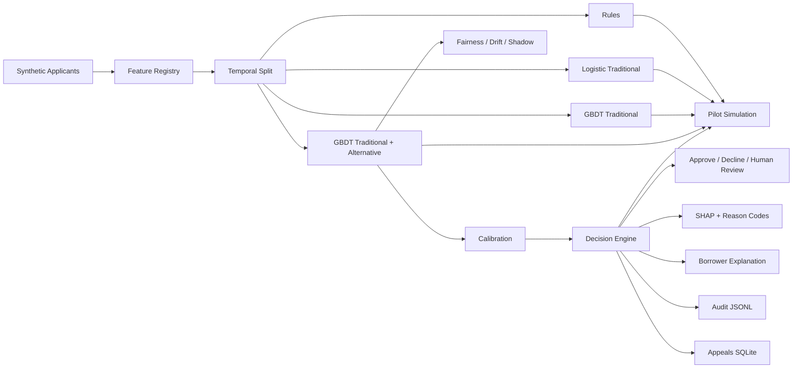

# Credit Sense — Offline Prototype

> **PROTOTYPE / SYNTHETIC DATA ONLY.** This repository is an engineering demonstration, not a validated lending model. No real borrowers, real credit bureau records, or real lender data are used. Synthetic performance does not establish production validity, legal compliance, disparate-impact safety, or creditworthiness.

## Purpose
Credit Sense is a local, alternative-data credit decisioning layer for U.S. community lenders serving thin-file/near-prime applicants. It demonstrates risk scoring, explainability, confidence-based human review, borrower explanations, audit logging, shadow mode, appeals, fairness analysis, drift monitoring, and a five-stage pilot simulation.

## Assumptions
- Synthetic applicant population of 20,000 rows; outcome is generated from a documented latent-risk process.
- Application dates enable temporal train/validation/test splits.
- Protected attributes are generated for auditing only and are never model features.
- Utility/rent payment regularity is permissioned alternative data; bank cash-flow variables are synthetic equivalents.
- No co-op/group-trust signals are used.
- The prototype uses scikit-learn HistGradientBoostingClassifier for boosted trees; it supports monotonic constraints and avoids requiring XGBoost/LightGBM.
- Confidence is a transparent proxy combining distance from the approval cutoff and probabilistic uncertainty p(1-p), not a statistical guarantee.
- Rule-based and incumbent stages are illustrative synthetic policies, not lender policy recommendations.

## Quick start
```bash
python -m venv .venv
# Windows: .venv\Scripts\activate
# macOS/Linux: source .venv/bin/activate
pip install -r requirements.txt
make all
```
If `make` is unavailable, run the same targets directly with the commands in the Makefile.

## Architecture


## Feature governance
Traditional features: credit score, history length, DTI, requested amount, term, on-time ratio, delinquencies, months since delinquency. Alternative features: utility/rent regularity, income volatility, average inflow, overdraft count, savings buffer, gig-income share, employment tenure. Protected/proxy fields are explicitly excluded from model matrices.

## Reproducibility
`make all` runs data generation, training, evaluation, fairness, pilot simulation, drift simulation, and tests using seed 42. Generated artifacts are under `outputs/` and models under `models/`.

## Offline/no-key guarantee
The application code contains no external API calls and no API keys. FastAPI and Streamlit run locally. The only installation dependency is Python packages listed in `requirements.txt`; those packages are free/open-source. In this execution sandbox, package-index network access is unavailable, so the included pipeline uses a local fairness fallback when Fairlearn is absent. On a normal connected laptop, `pip install -r requirements.txt` installs Fairlearn and Streamlit and the Fairlearn-backed path is used.

## Limitations
This is not a lending recommendation, not a compliance determination, and not evidence that alternative data improves real-world credit outcomes. Real Western labeled data, documented consent/permission, data-quality testing, independent validation, legal/compliance review, model-risk governance, security hardening, monitoring, and lender pilot evidence are required before any live use.
